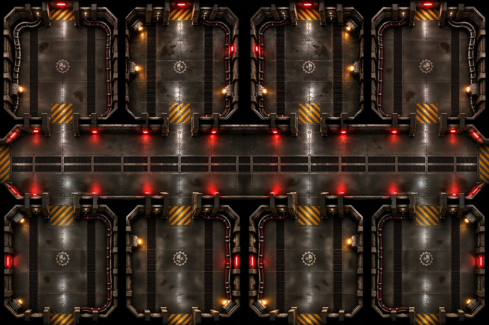

# 1. Тюремный блок

Блок стазис-камер, где герои просыпаются. Карта 4608×3072 — **36×24 клетки** по 128 px. Две половины по четыре камеры, вторая зеркальная. Камеры считаются слева направо: верхний ряд 1–4, нижний 5–8.

## Файлы

| Файл | Что это |
|---|---|
| `prison_cells8_4608x3072.webp` | Статичная карта |
| `cells8_anim_4608x3072.webm` | Петля 16 с — фон сцены |
| `cells8_anim_2304x1536.webm` | Лёгкая петля, 64 px на клетку |

## Что движется в петле

- Красные аварийные лампы дышат, жёлтые мигают.
- В камерах 1–5 сервиторы ходят каждый своим маршрутом, двое стоят в коридоре у дверей 6 и 7.
- В запертой восьмой погас свет, у двери бьют разряды.

## В Foundry

1. Фон сцены — петля, сетка 128 (или 64 для лёгкой).
2. Стены и двери камер ставятся поверх карты. Дверь восьмой камеры — запертая.
3. В восьмой камере тайник старого надзирателя: его находят, если вскроют дверь.
