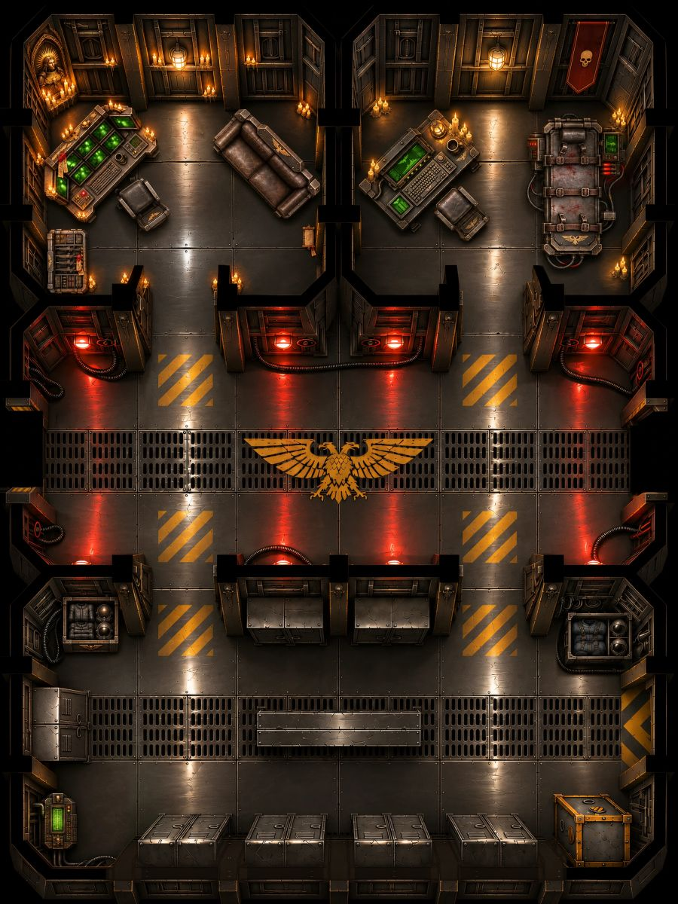

# 2. Пост охраны у выхода из блока

Карта 2304×3072 — **18×24 клетки** по 128 px. Коридор с плоской аквилой в полу и красными аварийными лампами.

- **Слева вверху — кабинет дежурного:** пульт наблюдения, диван, стул, пирамида с оружием, образ Императора, свечи, печати чистоты, череп на пульте.
- **Справа вверху — допросная:** стол с когитатором, стул, койка с ремнями, знамя с черепом, свечи.
- **Внизу — хранилище вещей и улик:** шкафчики, скамья, ящики с пустотными костюмами, когитатор учёта, ящик надзирателей.

**Выходы.** Слева тёмный проём — вход из блока камер. Справа такой же проём ведёт дальше в корабль. К залу этапа ведёт дверь с шевронами в хранилище.

## Файлы

| Файл | Что это |
|---|---|
| `post_guard_2304x3072.webp` | Статичная карта |
| `post_guard_anim_2304x3072.webm`, `…_1152x1536.webm` | Петля 16 с — фон сцены, полная и лёгкая |
| `post_guard_anim_skull_2304x3072.webm`, `…_1152x1536.webm` | Та же петля, но череп-протоколист вклеен в карту и летает восьмёркой между пультом и койкой |
| `servo_skull.webm` | Токен черепа-протоколиста, 768×768 с прозрачностью: парит, покачивается, глаз пульсирует |
| `servo_skull_token.webp` | Неподвижная картинка того же черепа для токена |
| `vox_imperator_zashishaet.ogg` | Звук вокса «Император защищает!», петля 12 с |

## Что движется в петле

- Свечи мерцают и колышутся.
- Фонарь допросной временами моргает, электрическая лампа на её столе горит ровно.
- Красные лампы дышат в такт блоку камер.
- На мониторах бегает полоса развёртки и вспыхивают данные, мигают светодиоды.

## В Foundry

1. Фон сцены — `post_guard_anim`. Дверь допросной ставится **запертой**.
2. В допросной — токен черепа: `servo_skull.webm`, размер 1×1, масштаб 2.
3. Там же звук вокса как окружающий звук (Ambient Sound) с `vox_imperator_zashishaet.ogg`. Ограничение стенами выключено, чтобы его было слышно из коридора.
4. **Вариант:** фоном поставить `post_guard_anim_skull`. Тогда череп уже летает по карте, и токен не нужен.
