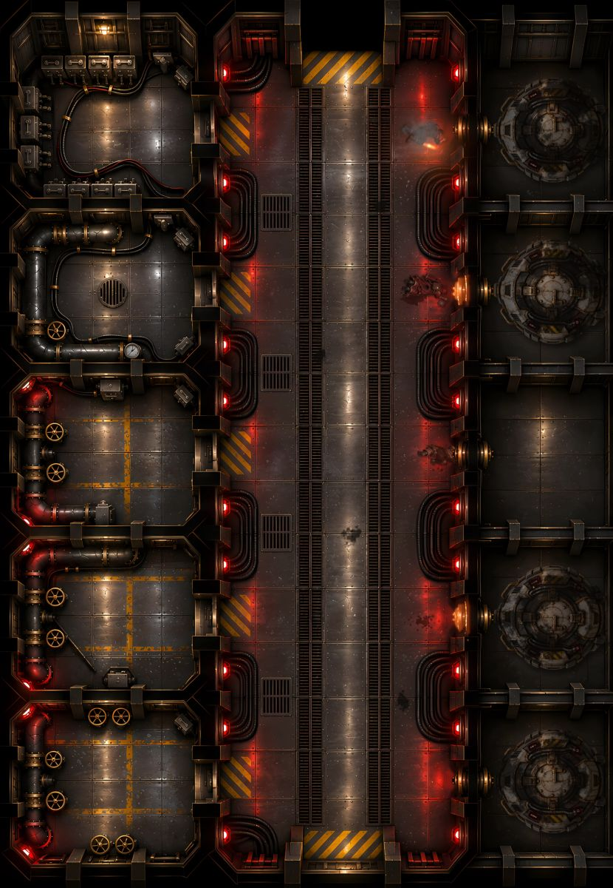

# 4. Шлюпочная палуба

Карта 2304×3328 — **18×26 клеток** по 128 px, длиннее соседних.

- **Слева** — пять служебных комнат, верхняя из них щитовая.
- **Справа** — пять отсеков шлюпок с круглыми люками, номера 5–9 сверху вниз.
- **Капсулы** разбиты все, кроме седьмой (она отдельным тайлом).
- **Тела** у люков 5, 6 и 7 нарисованы на карте.
- **Проходы.** Верхний закрыт: это выход. Внизу зала стоит турель.

## Файлы

| Файл | Что это |
|---|---|
| `lifeboats_deck_v8_2304x3328.webp` | Статичная карта без турели (кадр петли) |
| `lifeboats_deck_v9_2304x3328.webp` | Статичная карта с турелью |
| `lifeboats_deck_anim_…webm` | Петля без турели |
| `lifeboats_deck_fire_anim_…webm` | Петля со стреляющей турелью |
| `lifeboats_deck_dead_anim_…webm` | Петля с замершей (обезвреженной) турелью |
| `lifeboats_hall_fire_tile_1228x2536.webm`, `…_614x1268.webm` | Непрозрачный вырез зала со стреляющей турелью |
| `lifeboats_hall_dead_tile_1228x2536.webm`, `…_614x1268.webm` | Тот же вырез с замершей турелью |
| `turret/lifeboats_turret_anim_1024x1024.webm`, `…_512x512.webm` | Тайл турели, которая «следит»: голова рывками ходит на ±35°, искрит шланг |
| `turret/lifeboats_turret_off_1024.png` | Обезвреженная турель, картинка на то же место |
| `turret/turret_corridor_fire_1024x3072.webm`, `…_512x1536.webm` | Тайл «турель стреляет вдоль коридора», 4×12 клеток, для любой карты |
| `lifeboats_capsule7_tile.png` | Целая капсула за люком 7, 529×644 |
| `lifeboats_valve_stopped_104.png` | Неподвижный вентиль, 104×104 |
| `lifeboats_survivor_token_384.png` | Токен выжившего матроса Варро |
| `collar_beep_slow.ogg`, `collar_beep_fast.ogg` | Писк взрывных ошейников |

Все петли идут по 16 с, полные 2304×3328 и лёгкие 1152×1664.

## Что движется в петлях

- Настенные лампы зала дышат в общем такте.
- В разбитых капсулах искрит из выгоревших гнёзд огней.
- Заваренные люки 6 и 8 раскалены, накал дышит, изредка стреляет искра.
- Под матросом у люка 5 светится раскалённый плазменный пистолет, над телом ползёт дым.
- Вентиль во второй комнате слева рывками крутится туда-обратно.
- **Стреляющая турель** даёт три очереди по четыре выстрела: в 3,2 с в люк 8, в 7,2 с в левую стену, в 11,0 с в люк 6. На каждом выстреле отдача, вспышка, трассер, искры и дымок на месте попадания.
- **Замершая турель** стоит неподвижно, повёрнутая на −18°. Из оборванного шланга бьют искры, тянется дым.

## Турель в Foundry

**Основная схема.**
1. Фон — `lifeboats_deck_dead_anim`.
2. Поверх — тайл `lifeboats_hall_fire_tile` в (600, 792), на лёгкой карте в (300, 396).
3. Пока турель работает, тайл виден, и попадания идут по стенам. Когда её обезвредили, тайл скрыть.

Края выреза выбраны там, где петли совпадают, поэтому шва не видно.

**Если нужна турель, которая только «следит».**
1. Фон — `lifeboats_deck_anim`.
2. Тайл `turret/lifeboats_turret_anim` 4×4 клетки в (1032, 2640), стволами вверх.
3. Когда обезврежена, на то же место ставится `turret/lifeboats_turret_off_1024.png`.

## Остальные тайлы, токены и звуки

- **Капсула 7.** `lifeboats_capsule7_tile.png` стоит в (1775, 1380). Если Варро улетел на ней, тайл скрыть.
- **Вентиль.** `lifeboats_valve_stopped_104.png` 104×104 стоит в (160, 1186). Его ставят поверх петли, когда вентиль должен стоять неподвижно. На лёгкой карте он 52×52 в (80, 593).
- **Варро.** `lifeboats_survivor_token_384.png`, размер токена 1,5. Стоит во второй комнате слева, у двери в зал.
- **Ошейники.** По два звука у каждого люка, ограничение стенами выключено: `collar_beep_slow.ogg` с радиусом 3 клетки и `collar_beep_fast.ogg` с радиусом 1,5 клетки.
