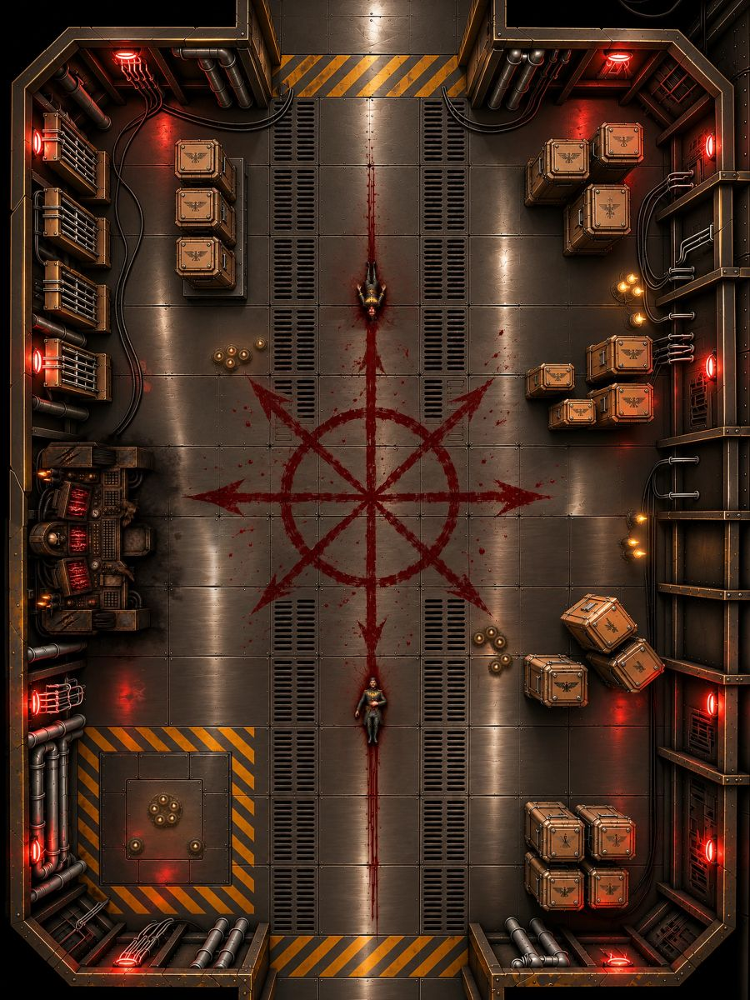
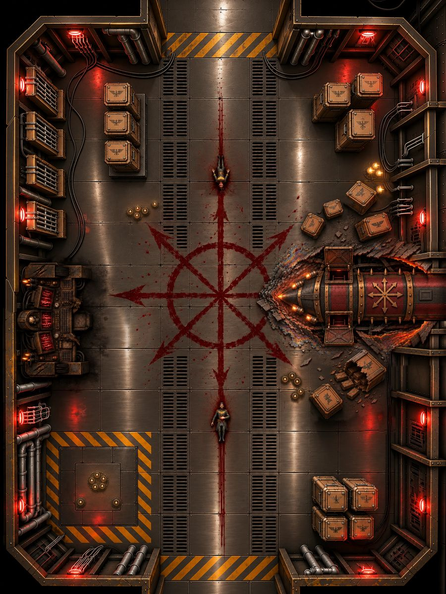

# 3. Зал этапа

| До пролома | После пролома |
|---|---|
|  |  |

Карта 2304×3072 — **18×24 клетки** по 128 px. Посреди зала звезда Хаоса из восьми стрелок, в её центре маяк-локатор культа: на него идёт торпеда.

- **У левой стены:** рамы с кандалами, осквернённый когитатор приёмки, грузовой лифт.
- **Вдоль правой стены:** штабеля ящиков с орлами.

Центр открыт, укрытия только у стен.

## Три состояния

### 1. До пролома

| Файл | Что это |
|---|---|
| `hall_etap_anim_2304x3072.webm`, `…_1152x1536.webm` | Петля 16 с — фон сцены |
| `hall_etap_2304x3072.webp` | Статичная карта |

В петле мерцают чёрные свечи, дышат красные лампы. Когитатор сбоит, над ним клубится тьма. По корпусу бьют красные разряды, из решёток пола вырывается пар.

### 2. Пролом

Абордажная торпеда пробивает правую стену.

| Файл | Что это | Где ставить (полная / лёгкая) |
|---|---|---|
| `hall_breach_piece_1152x1536.webm`, `…_576x768.webm` | Видео пролома со звуком, 3,76 с, с прозрачностью, проигрывается один раз | (1152, 820) / (576, 410) |
| `hall_breach_zone_anim_1248x2104.webm`, `…_624x1052.webm` | Петля зоны пролома с прозрачностью: тлеют края, искры, дым, повреждённые лампы | (1056, 756) / (528, 378) |
| `hall_etap_after_2304x3072.webp` | Статичная карта после пролома | — |

Последний кадр видео пролома совпадает с кадром 0,5 с петли зоны.

**Порядок.** В сцене из компендиума «Акт I — сцены» оба тайла уже стоят скрытыми, а макрос «Пролом» делает всё сам. Вручную:
1. Показать видео пролома и запустить его.
2. Когда видео закончится, показать тайл зоны (с 0,5 с) и скрыть видео.

Фон сцены не меняется: петля зоны лежит поверх петли зала.

### 3. Декомпрессия

В конце второго раунда давление выбивает торпеду из пролома, как пробку. В борту остаётся дыра в пустоту, свет гаснет. Это испытание 1: герои уходят через верхний шлюз.

| Файл | Что это | Где ставить (полная / лёгкая) |
|---|---|---|
| `hall_rip_piece_1152x1536.webm`, `…_576x768.webm` | Видео: торпеду вырывает, со звуком, 3,76 с, с прозрачностью | (1152, 820) / (576, 410) |
| `hall_dark_anim_2304x3072.webm`, `…_1152x1536.webm` | Тёмная петля — новый фон сцены | — |

В тёмной петле свет погас, туман и пыль тянутся к дыре, на изломах поблёскивает иней. В оплавленном металле тлеют красные трещины, над верхним шлюзом мигает красный огонь блокировки.

**Порядок.** Макрос «Декомпрессия» делает это сам. Вручную:
1. Показать видео вырывания поверх тайла зоны и запустить его.
2. Когда видео закончится, сменить фон сцены на `hall_dark_anim`.
3. Скрыть тайл зоны и тайл вырывания.

Последний кадр видео совпадает с тёмной картой.
