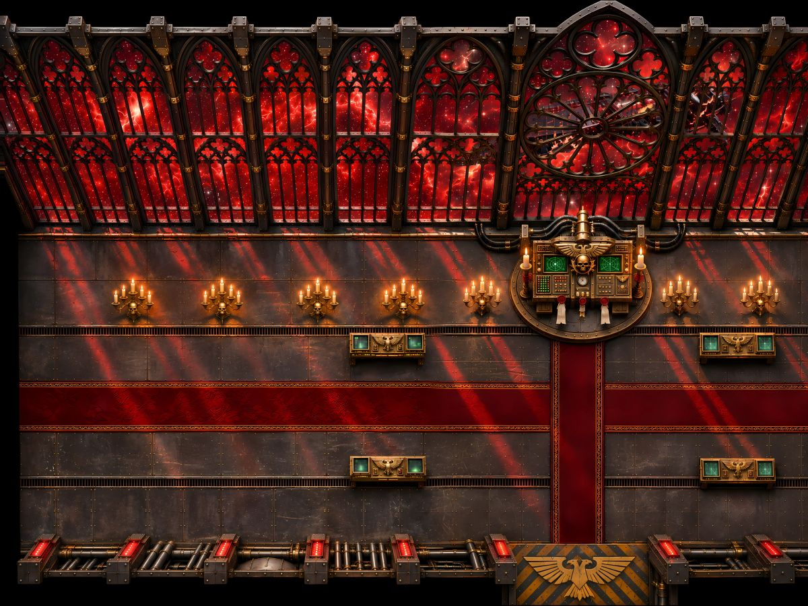
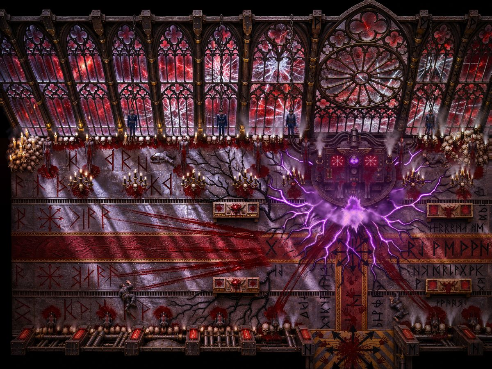

# 5. Смотровая галерея

| До прорыва варпа | После прорыва |
|---|---|
|  |  |

Карта 3072×2304 — **24×18 клеток** по 128 px.

- **Сверху** во всю ширину готический витраж с розеткой. За стеклом алая туманность и «Жатва Вечности».
- **Под розеткой** на круглом помосте вокс-когитатор.
- **Дорожка.** Красная дорожка идёт вниз к лифту в нижней стене (дверь лифта с плоским орлом).
- **Остальное:** четыре кафедры, семь канделябров, красные лампы вдоль нижней стены.

Обе карты совпадают с точностью до 1–3 px: стены и предметы на тех же местах. Поэтому стены в Foundry одни на оба состояния, при прорыве меняется только фон сцены.

## До прорыва

| Файл | Что это |
|---|---|
| `gallery_clean_anim_3072x2304.webm`, `…_1536x1152.webm` | Петля 16 с — фон сцены |
| `gallery_real_v7_3072x2304.webp` | Статичная карта |

Что движется:
- Свечи на канделябрах и на когитаторе мерцают, тёплый свет дышит.
- Туманность за стеклом клубится, звёзды мерцают.
- По окнам по очереди бьют разряды варпа. Молния видна только сквозь стекло, за переплётом и за кораблём. Стекло вспыхивает, отсвет ложится на пол вдоль красных лучей.
- Оранжевые огни «Жатвы» пульсируют.
- На радарах когитатора крутится луч (оборот за 4 с), при проходе луча загораются отметки целей. Мигают светодиоды.
- Экраны кафедр мерцают, по ним бежит полоса развёртки.
- Красные лампы дышат в общем такте.

## После прорыва варпа

| Файл | Что это |
|---|---|
| `gallery_desecrated_anim_3072x2304.webm`, `…_1536x1152.webm` | Петля 16 с — фон сцены |
| `gallery_v8_desecrated_dark_3072x2304.webp` | Статичная карта |

На карте:
- У окна висят на цепях четверо офицеров в форме флота.
- Тела на кольях вдоль подоконника и нижней стены.
- Руны, кровь, чёрные вены по полу.
- У алтаря разлом с лиловыми молниями в клубах лиловой дымки.
- Звезда из восьми стрелок на двери лифта, горки черепов по углам.

Что движется:
- Свечи мерцают.
- От разлома по полу бегут волны лилового света. Три раза за петлю бьёт сильный разряд, и пол освещается.
- Разлом, глаз когитатора и сердца на левых кафедрах бьются в одном ритме: 12 ударов «тук-тук» за петлю.
- Дымка медленно закручивается.
- В окнах бьют разряды варпа.
- Лампы дышат, из вентилей идёт пар, экраны когитатора сбоят.

## Переход

В момент прорыва макрос «Прорыв варпа» меняет фон сцены с `gallery_clean_anim` на `gallery_desecrated_anim`, повторный запуск возвращает чистую галерею. Вручную — сменить фон в настройках сцены. Отдельного видео самого прорыва пока нет. Из разлома поднимается Нерождённый, тварь варпа: статблок в компендиуме «Акт I — персонажи», бой расписан в тексте модуля.
